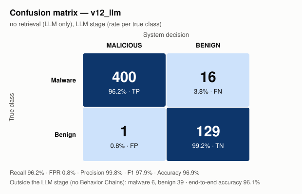

# Αποτελέσματα v12_llm — χωρίς ανάκτηση (μόνο LLM)

Αναφορές: 591/591 πακέτα

## Confusion matrix (στάδιο LLM)

| Πραγματική \ Απόφαση | MALICIOUS | BENIGN |
|---|---|---|
| **Malware** | TP = 400 | FN = 16 |
| **Benign** | FP = 1 | TN = 129 |

Εκτός σταδίου LLM (κανένα Behavior Chain): malware 6, benign 39.

## Μετρικές

| Μετρική | Τιμή | 95% διάστημα εμπιστοσύνης |
|---|---|---|
| Recall (στάδιο LLM) | **96,2%** (400/416) | [93,8% – 97,6%] |
| False positive rate | **0,8%** (1/130) | [0,1% – 4,2%] |
| Precision | **99,8%** | [98,6% – 100,0%] |
| F1 | **97,9%** | |
| Accuracy (στάδιο LLM) | **96,9%** | |
| Balanced accuracy | **97,7%** | |
| Recall end-to-end | 94,8% | |
| Accuracy end-to-end | 96,1% | |

## Ανά ζώνη ομοιότητας με το ευρετήριο

Μέγιστη ομοιότητα οποιουδήποτε Behavior Chain του πακέτου με το ευρετήριο (από την εκτέλεση `v12_sum`).

| Ζώνη | Malware | Recall | Benign | False positives |
|---|---|---|---|---|
| ≥0,98 γνωστή παραλλαγή | 235 | 231/235 = 98,3% | 29 | 0/29 = 0,0% |
| 0,90–0,98 κοντινό | 139 | 127/139 = 91,4% | 83 | 1/83 = 1,2% |
| <0,90 νέο | 42 | 42/42 = 100,0% | 18 | 0/18 = 0,0% |

## False positives (1)

Με ακριβώς ένα κακόβουλο Behavior Chain: 0/1.

| Πακέτο | Chains | Κακόβουλα | Μέγ. ομοιότητα | Κατηγορία / API / αρχείο του κακόβουλου chain |
|---|---|---|---|---|
| psutil | 94 | 2 | 0.9658 | file_ops `shutil.rmtree(...)` scripts/internal/purge_installation.py (sim 0.0, ATTEND); file_ops `tempfile.NamedTemporaryFile(...)` scripts/internal/install_pip.py (sim 0.0, ACT) |

## False negatives (16)

| Πακέτο | Chains | Μέγ. ομοιότητα |
|---|---|---|
| @bigid-ui | 2 | 0.9091 |
| celery-flower | 5 | 0.9136 |
| celium-collateral-upgrade | 3 | 0.931 |
| dmclc | 1 | 0.9329 |
| huzzleup | 1 | 0.954 |
| juk | 1 | 0.9359 |
| lium-4.96 | 19 | 0.9427 |
| pantheon-agents | 456 | 1.0 |
| pxhttp | 2 | 1.0 |
| pyphetools | 9 | 0.9735 |
| pyshftuler | 152 | 1.0 |
| rasterkit | 80 | 1.0 |
| set-utils | 2 | 0.9516 |
| set_utils | 2 | 0.926 |
| solana-web3-alt | 1 | 0.9221 |
| ttensorflow-gpu | 1 | 0.9138 |

Malware χωρίς Behavior Chains (static misses): NPM - coa - Versions diffs - 2.0.2 → 2.0.4 - Diffend - OSS supply chain security and management platform_files, atlassian-exp, atlassian-praz, free-onlyfans-no-subscription-premium-hack, guan, pyg-utils

_Παράγεται από το `results/results_analysis.py`. Σχόλια/ερμηνεία: `results/analysis/notes.md`._
