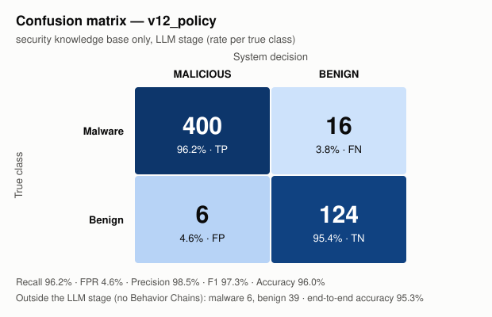

# Αποτελέσματα v12_policy — μόνο βάση γνώσης ασφάλειας

Αναφορές: 591/591 πακέτα

## Confusion matrix (στάδιο LLM)

| Πραγματική \ Απόφαση | MALICIOUS | BENIGN |
|---|---|---|
| **Malware** | TP = 400 | FN = 16 |
| **Benign** | FP = 6 | TN = 124 |

Εκτός σταδίου LLM (κανένα Behavior Chain): malware 6, benign 39.

## Μετρικές

| Μετρική | Τιμή | 95% διάστημα εμπιστοσύνης |
|---|---|---|
| Recall (στάδιο LLM) | **96,2%** (400/416) | [93,8% – 97,6%] |
| False positive rate | **4,6%** (6/130) | [2,1% – 9,7%] |
| Precision | **98,5%** | [96,8% – 99,3%] |
| F1 | **97,3%** | |
| Accuracy (στάδιο LLM) | **96,0%** | |
| Balanced accuracy | **95,8%** | |
| Recall end-to-end | 94,8% | |
| Accuracy end-to-end | 95,3% | |

## Ανά ζώνη ομοιότητας με το ευρετήριο

Μέγιστη ομοιότητα οποιουδήποτε Behavior Chain του πακέτου με το ευρετήριο (από την εκτέλεση `v12_sum`).

| Ζώνη | Malware | Recall | Benign | False positives |
|---|---|---|---|---|
| ≥0,98 γνωστή παραλλαγή | 235 | 228/235 = 97,0% | 29 | 4/29 = 13,8% |
| 0,90–0,98 κοντινό | 139 | 130/139 = 93,5% | 83 | 2/83 = 2,4% |
| <0,90 νέο | 42 | 42/42 = 100,0% | 18 | 0/18 = 0,0% |

## False positives (6)

Με ακριβώς ένα κακόβουλο Behavior Chain: 6/6.

| Πακέτο | Chains | Κακόβουλα | Μέγ. ομοιότητα | Κατηγορία / API / αρχείο του κακόβουλου chain |
|---|---|---|---|---|
| google-auth | 97 | 1 | 1.0 | process_exec `exec(...)` setup.py (sim 0.0, TRACK*) |
| daff | 15 | 1 | 0.9425 | process_exec `python_lib_Subprocess.call(...)` daff/__init__.py (sim 0.0, TRACK*) |
| opencensus | 8 | 1 | 1.0 | process_exec `exec(...)` setup.py (sim 0.0, ATTEND) |
| fabric | 6 | 1 | 1.0 | process_exec `exec(...)` setup.py (sim 0.0, TRACK*) |
| furl | 3 | 1 | 0.9623 | process_exec `exec(...)` setup.py (sim 0.0, TRACK*) |
| opentelemetry-exporter-gcp-monitoring | 1 | 1 | 0.9909 | process_exec `exec(...)` setup.py (sim 0.0, ATTEND) |

## False negatives (16)

| Πακέτο | Chains | Μέγ. ομοιότητα |
|---|---|---|
| @bigid-ui | 2 | 0.9091 |
| celery-flower | 5 | 0.9136 |
| celium-collateral-upgrade | 3 | 0.931 |
| colorfades | 2 | 0.9905 |
| dmclc | 1 | 0.9329 |
| easy-https | 8 | 1.0 |
| huzzleup | 1 | 0.954 |
| lightmock | 12 | 0.9847 |
| lium-4.96 | 19 | 0.9427 |
| pantheon-agents | 456 | 1.0 |
| pyphetools | 9 | 0.9735 |
| rasterkit | 80 | 1.0 |
| rblxtools | 2 | 1.0 |
| reuquests | 159 | 1.0 |
| set-utils | 2 | 0.9516 |
| set_utils | 2 | 0.926 |

Malware χωρίς Behavior Chains (static misses): NPM - coa - Versions diffs - 2.0.2 → 2.0.4 - Diffend - OSS supply chain security and management platform_files, atlassian-exp, atlassian-praz, free-onlyfans-no-subscription-premium-hack, guan, pyg-utils

_Παράγεται από το `results/results_analysis.py`. Σχόλια/ερμηνεία: `results/analysis/notes.md`._
