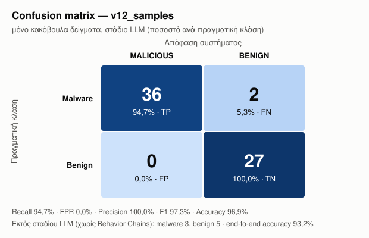

# Results v12_samples — malware samples only

Reports: 591/591 packages

## Confusion matrix (LLM stage)

| True \ Decision | MALICIOUS | BENIGN |
|---|---|---|
| **Malware** | TP = 402 | FN = 14 |
| **Benign** | FP = 4 | TN = 126 |

Outside the LLM stage (no Behavior Chain): malware 6, benign 39.

## Metrics

| Metric | Value | 95% confidence interval |
|---|---|---|
| Recall (LLM stage) | **96.6%** (402/416) | [94.4% – 98.0%] |
| False positive rate | **3.1%** (4/130) | [1.2% – 7.6%] |
| Precision | **99.0%** | [97.5% – 99.6%] |
| F1 | **97.8%** | |
| Accuracy (LLM stage) | **96.7%** | |
| Balanced accuracy | **96.8%** | |
| Recall end-to-end | 95.3% | |
| Accuracy end-to-end | 95.9% | |

## Per similarity stratum

Maximum similarity of any Behavior Chain of the package to the index (from the `v12_sum` run).

| Stratum | Malware | Recall | Benign | False positives |
|---|---|---|---|---|
| >=0.98 known variant | 235 | 232/235 = 98.7% | 29 | 2/29 = 6.9% |
| 0.90-0.98 close | 139 | 128/139 = 92.1% | 83 | 2/83 = 2.4% |
| <0.90 novel | 42 | 42/42 = 100.0% | 18 | 0/18 = 0.0% |

## False positives (4)

With exactly one malicious Behavior Chain: 4/4.

| Package | Chains | Malicious | Max similarity | Category / API / file of the malicious chain |
|---|---|---|---|---|
| psutil | 94 | 1 | 0.9658 | file_ops `tempfile.NamedTemporaryFile(...)` scripts/internal/install_pip.py (sim 0.9377, ACT) |
| qtconsole | 21 | 1 | 0.9909 | process_exec `exec(...)` setup.py (sim 0.9909, TRACK*) |
| daff | 15 | 1 | 0.9425 | process_exec `call(...)` setup.py (sim 0.9172, ATTEND) |
| fabric | 6 | 1 | 1.0 | process_exec `exec(...)` setup.py (sim 1.0, ATTEND) |

## False negatives (14)

| Package | Chains | Max similarity |
|---|---|---|
| @bigid-ui | 2 | 0.9091 |
| ansiicolor | 1 | 1.0 |
| celery-flower | 5 | 0.9136 |
| celium-collateral-upgrade | 3 | 0.931 |
| dmclc | 1 | 0.9329 |
| huzzleup | 1 | 0.954 |
| juk | 1 | 0.9359 |
| lium-4.96 | 19 | 0.9427 |
| moneyprinter-api | 1 | 0.9138 |
| pohttp | 2 | 1.0 |
| pyphetools | 9 | 0.9735 |
| rasterkit | 80 | 1.0 |
| set_utils | 2 | 0.926 |
| ttensorflow-gpu | 1 | 0.9138 |

Malware without Behavior Chains (static misses): NPM - coa - Versions diffs - 2.0.2 → 2.0.4 - Diffend - OSS supply chain security and management platform_files, atlassian-exp, atlassian-praz, free-onlyfans-no-subscription-premium-hack, guan, pyg-utils

_Generated by `results/results_analysis.py`. Comments / interpretation: `results/analysis/notes.md`._
