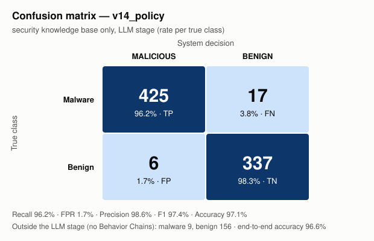

# Results v14_policy — security knowledge base only

Reports: 950/950 packages

## Confusion matrix (LLM stage)

| True \ Decision | MALICIOUS | BENIGN |
|---|---|---|
| **Malware** | TP = 425 | FN = 17 |
| **Benign** | FP = 6 | TN = 337 |

Outside the LLM stage (no Behavior Chain): malware 9, benign 156.

## Metrics

| Metric | Value | 95% confidence interval |
|---|---|---|
| Recall (LLM stage) | **96.2%** (425/442) | [93.9% – 97.6%] |
| False positive rate | **1.7%** (6/343) | [0.8% – 3.8%] |
| Precision | **98.6%** | [97.0% – 99.4%] |
| F1 | **97.4%** | |
| Accuracy (LLM stage) | **97.1%** | |
| Balanced accuracy | **97.2%** | |
| Recall end-to-end | 94.2% | |
| Accuracy end-to-end | 96.6% | |

## Per similarity stratum

Maximum similarity of any Behavior Chain of the package to the index (from the `v14_sum` run).

| Stratum | Malware | Recall | Benign | False positives |
|---|---|---|---|---|
| >=0.98 known variant | 239 | 237/239 = 99.2% | 63 | 4/63 = 6.3% |
| 0.90-0.98 close | 157 | 142/157 = 90.4% | 231 | 2/231 = 0.9% |
| <0.90 low similarity | 46 | 46/46 = 100.0% | 49 | 0/49 = 0.0% |

## False positives (6)

With exactly one malicious Behavior Chain: 5/6.

| Package | Chains | Malicious | Max similarity | Category / API / file of the malicious chain |
|---|---|---|---|---|
| numpy | 1414 | 1 | 1.0 | crypto_obfuscation `unescape(match[1])` doc/source/_static/scipy-mathjax/MathJax.js (sim 0.0, TRACK*) |
| browser-harness | 61 | 2 | 1.0 | process_exec `exec(...)` src/browser_harness/run.py (sim 0.0, TRACK*); process_exec `subprocess.Popen(...)` src/browser_harness/telemetry.py (sim 0.0, ATTEND) |
| langgraph-cli | 22 | 1 | 0.9602 | network `urllib.request.urlopen(...)` langgraph_cli/analytics.py (sim 0.0, TRACK*) |
| opentelemetry-exporter-gcp-logging | 6 | 1 | 0.9909 | process_exec `exec(...)` setup.py (sim 0.0, ATTEND) |
| fastspec | 1 | 1 | 0.927 | process_exec `compile(...)` fastspec/spec.py (sim 0.0, TRACK*) |
| opentelemetry-exporter-gcp-monitoring | 1 | 1 | 0.9909 | process_exec `exec(...)` setup.py (sim 0.0, ATTEND) |

## False negatives (17)

| Package | Chains | Max similarity |
|---|---|---|
| @bigid-ui | 2 | 0.9091 |
| celery-flower | 5 | 0.9136 |
| celium-collateral-upgrade | 3 | 0.931 |
| discord-request | 1 | 0.9282 |
| dmclc | 1 | 0.9329 |
| huzzleup | 1 | 0.954 |
| indextts-cli | 59 | 0.9435 |
| lium-4.96 | 19 | 0.9427 |
| neutrl-core | 1 | 0.9024 |
| notebook-intelligence | 183 | 0.9635 |
| pynosist | 30 | 1.0 |
| pyphetools | 9 | 0.9735 |
| qontract-reconcile | 173 | 0.9774 |
| rasterkit | 80 | 1.0 |
| set-utils | 2 | 0.9516 |
| set_utils | 2 | 0.926 |
| ttensorflow-gpu | 1 | 0.9138 |

Malware without Behavior Chains (static misses): NPM - coa - Versions diffs - 2.0.2 → 2.0.4 - Diffend - OSS supply chain security and management platform_files, atlassian-exp, atlassian-praz, cubesat-upstream-driver, free-onlyfans-no-subscription-premium-hack, guan, linting, pyg-utils, wayspiritmcp-enconly

_Generated by `results/results_analysis.py`. Comments / interpretation: `results/analysis/notes.md`._
