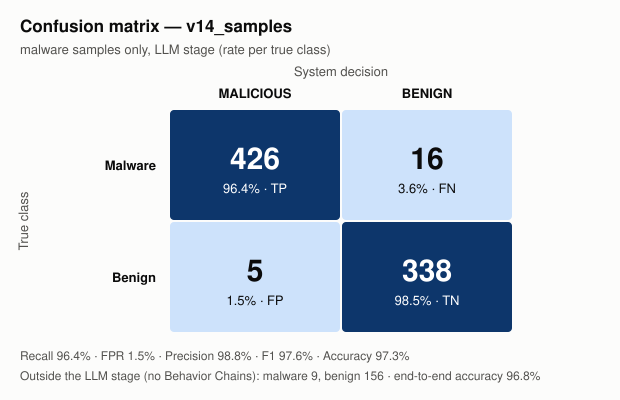

# Results v14_samples — malware samples only

Reports: 950/950 packages

## Confusion matrix (LLM stage)

| True \ Decision | MALICIOUS | BENIGN |
|---|---|---|
| **Malware** | TP = 426 | FN = 16 |
| **Benign** | FP = 5 | TN = 338 |

Outside the LLM stage (no Behavior Chain): malware 9, benign 156.

## Metrics

| Metric | Value | 95% confidence interval |
|---|---|---|
| Recall (LLM stage) | **96.4%** (426/442) | [94.2% – 97.8%] |
| False positive rate | **1.5%** (5/343) | [0.6% – 3.4%] |
| Precision | **98.8%** | [97.3% – 99.5%] |
| F1 | **97.6%** | |
| Accuracy (LLM stage) | **97.3%** | |
| Balanced accuracy | **97.5%** | |
| Recall end-to-end | 94.5% | |
| Accuracy end-to-end | 96.8% | |

## Per similarity stratum

Maximum similarity of any Behavior Chain of the package to the index (from the `v14_sum` run).

| Stratum | Malware | Recall | Benign | False positives |
|---|---|---|---|---|
| >=0.98 known variant | 239 | 239/239 = 100.0% | 63 | 2/63 = 3.2% |
| 0.90-0.98 close | 157 | 142/157 = 90.4% | 231 | 3/231 = 1.3% |
| <0.90 low similarity | 46 | 45/46 = 97.8% | 49 | 0/49 = 0.0% |

## False positives (5)

With exactly one malicious Behavior Chain: 4/5.

| Package | Chains | Malicious | Max similarity | Category / API / file of the malicious chain |
|---|---|---|---|---|
| psutil | 94 | 1 | 0.9658 | file_ops `tempfile.NamedTemporaryFile(...)` scripts/internal/install_pip.py (sim 0.9377, ACT) |
| browser-harness | 61 | 2 | 1.0 | network `urllib.request.urlopen(...)` src/browser_harness/daemon.py (sim 0.9907, ATTEND); process_exec `subprocess.Popen(...)` src/browser_harness/telemetry.py (sim 0.8141, ATTEND) |
| langgraph-cli | 22 | 1 | 0.9602 | network `urllib.request.urlopen(...)` langgraph_cli/analytics.py (sim 0.9602, ACT) |
| daff | 15 | 1 | 0.9425 | process_exec `call(...)` setup.py (sim 0.9172, ATTEND) |
| opentelemetry-exporter-gcp-monitoring | 1 | 1 | 0.9909 | process_exec `exec(...)` setup.py (sim 0.9909, ATTEND) |

## False negatives (16)

| Package | Chains | Max similarity |
|---|---|---|
| @bigid-ui | 2 | 0.9091 |
| audit-themis-i18n | 1 | 0.893 |
| celery-flower | 5 | 0.9136 |
| celium-collateral-upgrade | 3 | 0.931 |
| discord-request | 1 | 0.9282 |
| dmclc | 1 | 0.9329 |
| huzzleup | 1 | 0.954 |
| indextts-cli | 59 | 0.9435 |
| lium-4.96 | 19 | 0.9427 |
| neutrl-core | 1 | 0.9024 |
| notebook-intelligence | 183 | 0.9635 |
| pyphetools | 9 | 0.9735 |
| qontract-reconcile | 173 | 0.9774 |
| set-utils | 2 | 0.9516 |
| set_utils | 2 | 0.926 |
| ttensorflow-gpu | 1 | 0.9138 |

Malware without Behavior Chains (static misses): NPM - coa - Versions diffs - 2.0.2 → 2.0.4 - Diffend - OSS supply chain security and management platform_files, atlassian-exp, atlassian-praz, cubesat-upstream-driver, free-onlyfans-no-subscription-premium-hack, guan, linting, pyg-utils, wayspiritmcp-enconly

_Generated by `results/results_analysis.py`. Comments / interpretation: `results/analysis/notes.md`._
