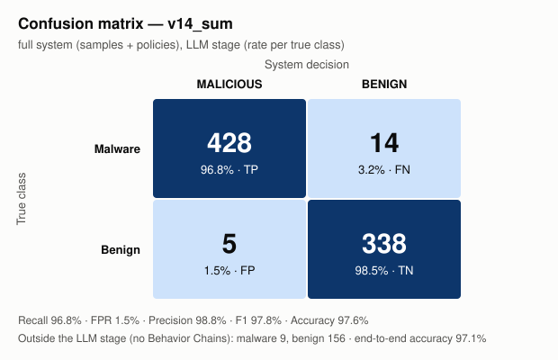

# Results v14_sum — full system (samples + policies)

Reports: 950/950 packages

## Confusion matrix (LLM stage)

| True \ Decision | MALICIOUS | BENIGN |
|---|---|---|
| **Malware** | TP = 428 | FN = 14 |
| **Benign** | FP = 5 | TN = 338 |

Outside the LLM stage (no Behavior Chain): malware 9, benign 156.

## Metrics

| Metric | Value | 95% confidence interval |
|---|---|---|
| Recall (LLM stage) | **96.8%** (428/442) | [94.8% – 98.1%] |
| False positive rate | **1.5%** (5/343) | [0.6% – 3.4%] |
| Precision | **98.8%** | [97.3% – 99.5%] |
| F1 | **97.8%** | |
| Accuracy (LLM stage) | **97.6%** | |
| Balanced accuracy | **97.7%** | |
| Recall end-to-end | 94.9% | |
| Accuracy end-to-end | 97.1% | |

## Per similarity stratum

Maximum similarity of any Behavior Chain of the package to the index (from the `v14_sum` run).

| Stratum | Malware | Recall | Benign | False positives |
|---|---|---|---|---|
| >=0.98 known variant | 239 | 237/239 = 99.2% | 63 | 3/63 = 4.8% |
| 0.90-0.98 close | 157 | 146/157 = 93.0% | 231 | 2/231 = 0.9% |
| <0.90 low similarity | 46 | 45/46 = 97.8% | 49 | 0/49 = 0.0% |

## False positives (5)

With exactly one malicious Behavior Chain: 5/5.

| Package | Chains | Malicious | Max similarity | Category / API / file of the malicious chain |
|---|---|---|---|---|
| swebench | 45 | 1 | 0.9287 | network `urllib.request.urlopen(...)` swebench/harness/run_evaluation.py (sim 0.9121, TRACK*) |
| langgraph-cli | 22 | 1 | 0.9602 | network `urllib.request.urlopen(...)` langgraph_cli/analytics.py (sim 0.9602, ATTEND) |
| alibabacloud-tea-openapi | 6 | 1 | 1.0 | process_exec `__import__(...)` setup.py (sim 1.0, ATTEND) |
| opentelemetry-exporter-gcp-logging | 6 | 1 | 0.9909 | process_exec `exec(...)` setup.py (sim 0.9909, ACT) |
| databricks-labs-blueprint | 5 | 1 | 1.0 | process_exec `exec(...)` databricks/labs/blueprint/wheels.py (sim 0.962, TRACK*) |

## False negatives (14)

| Package | Chains | Max similarity |
|---|---|---|
| @bigid-ui | 2 | 0.9091 |
| celery-flower | 5 | 0.9136 |
| celium-collateral-upgrade | 3 | 0.931 |
| huzzleup | 1 | 0.954 |
| juk | 1 | 0.9359 |
| lium-4.96 | 19 | 0.9427 |
| neutrl-core | 1 | 0.9024 |
| notebook-intelligence | 183 | 0.9635 |
| pantheon-agents | 456 | 1.0 |
| pyphetools | 9 | 0.9735 |
| qontract-reconcile | 173 | 0.9774 |
| rasterkit | 80 | 1.0 |
| set_utils | 2 | 0.926 |
| uncrypt | 1 | 0.8601 |

Malware without Behavior Chains (static misses): NPM - coa - Versions diffs - 2.0.2 → 2.0.4 - Diffend - OSS supply chain security and management platform_files, atlassian-exp, atlassian-praz, cubesat-upstream-driver, free-onlyfans-no-subscription-premium-hack, guan, linting, pyg-utils, wayspiritmcp-enconly

_Generated by `results/results_analysis.py`. Comments / interpretation: `results/analysis/notes.md`._
